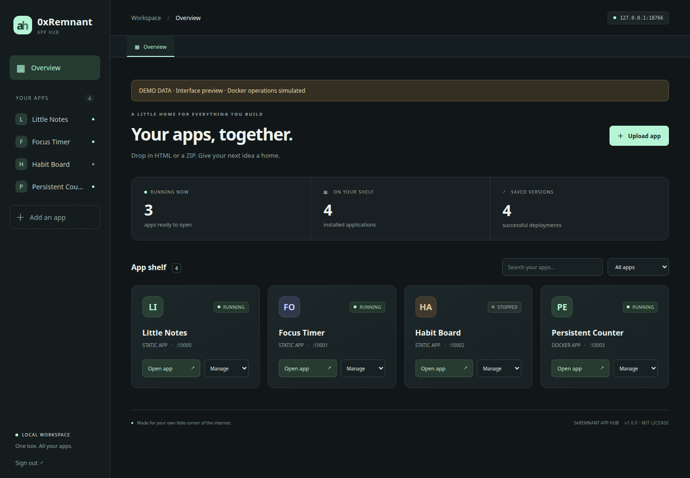

# 0xRemnant App Hub

A free, self-hosted home for your small web apps. Upload an HTML file or ZIP project, then open the app
in a tab inside the dashboard or in its own browser window. MIT licensed. No
subscription, cloud account, paid service, or domain name is required.

One Linux VM in Proxmox runs the whole system. Every app uses the same VM IP
with its own stable, automatically assigned port. There is no per-app DNS or
reverse-proxy configuration to maintain.



Screenshots use disposable demo data and a modeled Docker runtime. They show the
actual dashboard UI; they are not proof of a completed Docker deployment.
[Upload screen](docs/screenshots/upload.png) ·
[App tab](docs/screenshots/app-tab.png) ·
[Mobile layout](docs/screenshots/mobile.png)

See [Security](SECURITY.md), [verification limits](TESTING.md), and the
[publication review](docs/REVIEW.md) before storing important data.

## Install in your Proxmox VM

1. Create an **Ubuntu Server 24.04, Debian 12/13, or a maintained Fedora Server VM**, with a bridged network
   adapter. A starting allocation is 2–4 vCPUs, 4–8 GB RAM, and 40–80 GB disk.
   Give it a DHCP reservation or a static address. Run these steps inside that
   VM, rather than in the Proxmox host shell.
2. Clone this repository into the VM:

   ```sh
   git clone https://github.com/Sm4Rk-Slynxy/0xRemnant-App-Hub.git
   cd 0xRemnant-App-Hub
   ```

   Alternatively, extract the source ZIP and enter its directory:

   ```sh
   unzip 0xRemnant-App-Hub.zip
   cd 0xRemnant-App-Hub
   ```

   If `unzip` is missing, use `sudo apt-get install unzip` on Ubuntu/Debian,
   or `sudo dnf install unzip` on Fedora.

3. If Docker Engine and its Compose plugin are not installed:

   ```sh
   sudo sh install-docker.sh
   ```

   This script installs Docker from its official apt repository on Ubuntu/Debian
   or its official RPM repository on Fedora (DNF5, with a DNF4 fallback).
   It is intended for a fresh VM and will not remove an existing
   distribution Docker/container installation. For an existing installation,
   use its working Docker Engine and Compose plugin or follow the official
   [Ubuntu](https://docs.docker.com/engine/install/ubuntu/),
   [Debian](https://docs.docker.com/engine/install/debian/), or
   [Fedora](https://docs.docker.com/engine/install/fedora/) migration instructions.

4. Start App Hub:

   ```sh
   sudo sh start.sh
   ```

5. Open **`http://YOUR-VM-IP:8080`**. In your VM terminal, read the first-run
   setup token:

   ```sh
   sudo sh compose.sh exec hub python -m apphub.server --show-setup-token
   ```

   Paste that token into the setup screen and choose an owner password with at
   least 12 characters. The token is deleted after setup. An existing owner only
   needs the password; upgrades do not require another setup token.
6. Click **Try it with an example ZIP**, then upload the downloaded ZIP.

The first build downloads container images. Allow the VM outbound internet
access for image pulls and dependency installation. Your apps are served locally.
After a successful deployment, they do not depend on this chat or a hosted service.

For network/VPN access, allow TCP **8080** and **10000–10999** to the VM from
your trusted network. The hub is intended for home-network/VPN access. Do not
forward these ports from the internet. Docker-published ports can bypass ufw;
use the Proxmox/router firewall for access restrictions.

## Fedora setup

Use a standard, maintained **Fedora Server or Workstation** installation in the VM.
Silverblue, Kinoite, and CoreOS/rpm-ostree installs are not handled by this installer.
The install/start commands above are the same on all three supported distributions.

App Hub uses **Docker Engine**, rather than Podman's Docker-compatibility socket.
Standalone Podman can remain installed. If `podman-docker` or another conflicting
container package is present, the installer stops and names it; it does not remove
packages or existing containers automatically.

Always run Compose operations through the included wrapper:

```sh
sudo sh compose.sh ps
sudo sh compose.sh logs -f hub
sudo sh compose.sh up -d --build
```

`start.sh` uses this wrapper too. When SELinux is enabled (including permissive
mode), the wrapper adds `compose.selinux.yaml`. That override uses
`security_opt: [label=disable]` **only for the hub management container**, so it can
access the Docker API socket. System-wide SELinux stays enabled, the socket is not
relabelled with `:z`/`:Z`, and hosted app containers keep their normal settings.
This follows Docker's documented [per-container label option](https://docs.docker.com/reference/cli/docker/container/run/#optional-security-options).
If using raw `docker compose` commands on an SELinux host, include both files:
`docker compose -f compose.yaml -f compose.selinux.yaml ...`.

The installer does not change firewalld rules. Docker manages bridge-network and
published-port rules, including a `docker` firewalld zone; see
[Docker's firewalld integration](https://docs.docker.com/engine/network/packet-filtering-firewalls/#integration-with-firewalld).
Use the Proxmox/router firewall to limit the VM's ports to your LAN/VPN as described
above. If the dashboard is accessible but reports Docker unavailable on Fedora,
check `sudo sh compose.sh config` for `label=disable`, and restart through `start.sh`.

## What is included

- Password-protected owner dashboard, with sessions isolated from app origins.
- HTML/HTM and ZIP drag-and-drop, upload progress, automatic detection, and a build queue.
- Static HTML, prebuilt frontends, common npm-based Vite/React builds, Node
  servers, and custom Dockerfiles.
- Stable app addresses, without changing asset paths or application routing.
- In-dashboard tabs that preserve each app's frame while switching tabs.
- Open in browser tab, reload, search, status filters, and app logs.
- Updating an app by uploading replacement HTML or a ZIP project.
- Successful version history and restoring older images and environment values.
- Per-app persistent Docker data volumes mounted at `/data`.
- Start, stop, restart, and remove controls.
- HTTP startup checks and restoring the previous running container when an
  update fails to start. Building a new image does not stop the old app.
- CPU, memory, process, and runtime log limits.
- An example static app and a Python backend example with persistent SQLite data.

## Supported uploads

An outer project folder is accepted. Exclude `node_modules`, `.git`, build caches,
and large assets you do not need. Maximum upload: 100 MiB. Maximum expanded size:
500 MiB / 10,000 ZIP entries. Symlinks, unsafe paths, and encrypted ZIPs are rejected.
Uploaded environment files (including `.env.example`), common credential/key
files, `.ssh`/cloud credential folders, database files, logs, and backups are
excluded. Enter runtime secrets in the optional environment settings field.
This filter cannot find secrets embedded in ordinary source files; inspect your
project before uploading or publishing it.

### Standalone HTML files

Upload **any-name.html** or **any-name.htm** directly. No ZIP is needed. The hub
selects Static mode and serves the uploaded file as the app's home page
(`index.html`), preserving its HTML, inline styles, and JavaScript. HTML updates
use the same app address and version-history workflow as ZIP updates.

Try the included `examples/hello-app.html`. It is the same Little Notes app as
`hello-app.zip`, provided as a standalone file.

If your HTML refers to separate local CSS, JavaScript, images, or other assets,
upload a ZIP containing those files together. Uploading only the HTML cannot
supply missing companion files. Externally hosted assets still need network
access. Server code and React/Vite source projects continue to require a ZIP.

### HTML projects and prebuilt frontends

ZIP a folder containing `index.html`, its JS/CSS, and its other assets. You can
also upload a project containing `dist/index.html` or `build/index.html`.
For a plain static ZIP with exactly one top-level HTML/HTM page, the hub creates
an `index.html` alias even if that page has another name; its original URL and
companion assets are kept. For multiple HTML pages, name the entry page `index.html`.
Extensionless HTML navigations fall back to `index.html`, so frontend routes can
be opened directly. Missing assets return 404. Static apps run as an unprivileged
user. Directory listing, hidden/private files, and common project configuration
files are not served. Keep static assets free of API keys and personal data. Their browser localStorage remains separate for each app port.

### React / Vite

Upload the source project with `package.json` and preferably `package-lock.json`.
When Vite or react-scripts and a build script are present, the hub runs `npm ci`
(or `npm install` without a lockfile), runs `npm run build`, then serves `dist/`
(or `build/` for react-scripts). Source `index.html` is not served before the build.

Custom output directory:

```json
{"type":"static", "static_dir":"public-build"}
```

The npm automatic builders use Node 22. Projects requiring another version,
pnpm, Bun, or Yarn can supply a Dockerfile instead.

### Node / Next.js servers

Include `package.json` with an `npm start` script. The hub installs dependencies,
runs `npm run build` if defined, and starts the app using `npm start`.
The default internal port is **3000**. The generated environment supplies
`PORT=3000`, `HOST=0.0.0.0`, and `HOSTNAME=0.0.0.0`; your server must honor these
or explicitly listen on `0.0.0.0` at the internal port you select.

### Python and other server apps

Include a **Dockerfile** at the project root and set the internal port in
`apphub.json` or the upload form. The hub builds and runs that image. A Dockerfile
takes priority during automatic detection. The included `python-counter.zip`
demonstrates a backend that persists data across app updates.

This version runs **one container per app**. It does not import Docker Compose
stacks or automatically provision database servers. Use SQLite in `/data`, or
connect to an existing database through environment settings. Apps that depend
on an external cloud API/database still need that service and its credentials.

### Optional apphub.json

Put this beside your Dockerfile or package.json:

```json
{
  "type": "docker",
  "port": 8080,
  "health_path": "/health"
}
```

`type` can be `auto`, `static`, `node`, or `docker`. `port` is the **internal**
container port, not the external port assigned by App Hub. A form setting
overrides the manifest. A successful startup check is an HTTP 2xx/3xx response,
or HTTP 401/403 for an authenticated app. Use `health_path` if `/` returns 404.

## Updating apps and preserving data

Choose **Manage → Upload update** and select new HTML or a ZIP project. Its external port
stays the same. Blank environment settings keep existing values. A `KEY=value`
line adds or replaces that key; `KEY=` sets an empty string. Values are passed
at runtime, and are not injected as Docker build arguments.

Write persistent server files, SQLite databases, and uploads to **`/data`**.
Writes elsewhere inside a container are replaced during updates. For custom
images with a non-root `USER`, create `/data` with the intended ownership in the
Dockerfile so Docker initializes the new volume with those permissions.

Static browser localStorage is saved by the browser, not in the VM. It persists
for the same app address/port in that browser. It is not a shared multi-user
database and is not part of the server backup.

Updates briefly stop the old app after the new image has built. If startup
fails, the hub attempts to restart the previous running container. Restoring
a version restores its image and environment values; it **does not reverse data
changes or database migrations**. Back up data before deploying schema changes.

Removing an app deletes its container, card, and version history, but keeps
`apphub-data-APP_ID`. Images are also retained. The deployment log and app IDs
can help identify the corresponding volume before removal. Use `docker volume ls`
to inspect retained volumes; remove a volume only after backing up its contents.
There is no automatic image pruning in this version.

## Updating App Hub itself

For an existing installation, extract the updated `apphub-free.zip` over your
App Hub source directory and run `sudo sh start.sh` from that directory. This
rebuilds/recreates the hub container. Keep your existing `.env`; the release ZIP
does not include or replace it. App registry, saved versions, and app data remain
in their Docker volumes. Do not remove those volumes. Refresh the browser after
the rebuild to load the updated upload screen.

## Configuration

Copy `.env.example` to `.env` before the first start if you want different limits:

```sh
cp .env.example .env
```

- `APPHUB_PORT`: dashboard port (default 8080).
- `APPHUB_BIND_IP`: publish hub/apps on this VM address (default 0.0.0.0).
- `APPHUB_PORT_START` / `APPHUB_PORT_END`: range for new apps (10000–10999).
- `APPHUB_APP_MEMORY`: per-app runtime memory limit (512m).
- `APPHUB_APP_CPUS`: per-app CPU limit (1).
- `APPHUB_START_TIMEOUT`: seconds allowed for app startup (90).
- `APPHUB_ALLOWED_HOSTS`: comma-separated extra dashboard hostnames. IP addresses
  and localhost already work.

Apply changes with `sudo sh compose.sh up -d --build`. Existing app container
limits/bind addresses change on their next deployment. Existing assigned ports
are preserved even if you change the allocation range. The hub detects conflicting
ports through Docker and reports an error rather than stopping other software.

App addresses use plain HTTP, appropriate to the intended LAN/VPN setup. If you
later place an HTTPS reverse proxy in front of the hub, embedded HTTP apps can
be blocked as mixed content; use separate browser tabs or add HTTPS for the apps.
Some applications also restrict framing. Use **Open in new tab** for those apps.

## Storage, backups, and recovery

Everything is stored on the VM in Docker:

- `apphub-hub-data`: owner password hash, sessions, registry, environment values,
  release records, and deployment logs.
- `apphub-data-APP_ID`: each app's persistent `/data` directory.
- Docker image storage: each successfully built app image and retained versions.

The simplest complete backup is a **Proxmox backup of the whole VM**. Shut down
the VM for a consistent backup of databases. Include the disk containing Docker
storage. A whole-VM restore preserves IP configuration, images, app ports,
environment values, and data together. Copy backups off the VM.

Do not run `docker compose down -v` as an update or reset command: it removes
the hub's registry volume. Keep that registry backed up alongside app data.

If you forget the owner password, stop the hub, change the password interactively,
and restart it. Existing login sessions are revoked:

```sh
sudo sh compose.sh stop hub
sudo sh compose.sh run --rm --no-deps hub python -m apphub.server --data /data --reset-password
sudo sh compose.sh up -d
```

## Access model

The owner dashboard can build images and control Docker, so its container has the
Docker socket mounted. Only upload your own/trusted apps. Hosted app containers
do not receive the socket or dashboard session token. App ports are distinct
browser origins; the hub uses a bearer session kept in its own sessionStorage,
rather than a cookie that would also be sent to other ports on the same IP.
Cookies belong to the hostname, regardless of port. If multiple hosted apps use
session cookies, give those apps different cookie names (for example,
`recipes_session` and `projects_session`) to prevent cookie-name collisions.

The owner password protects **management**. Hosted apps are directly reachable
on their app ports from the permitted network and must provide their own login
if needed. Environment settings are kept in the private registry on disk; treat
that volume and its backups as sensitive. Logs redact exact known environment
values, including values split across build-output chunks. Transformed, encoded,
partial, or unknown secrets can still appear; inspect logs before sharing.
Default HTTP traffic is not encrypted. Keep access on a trusted LAN/VPN and use
a dedicated VM for Docker. See [SECURITY.md](SECURITY.md) for the trust model.

## Troubleshooting

```sh
sudo sh compose.sh ps
sudo sh compose.sh logs --tail=100 hub
sudo docker ps -a --filter label=com.apphub.managed=1
```

- **Docker unavailable:** confirm the socket mount, Docker service, and Compose
  startup. The dashboard can be viewed without Docker; deployments need it.
- **App not ready:** check the internal port, listen address `0.0.0.0`, health path,
  required settings, app log, and runtime memory limit.
- **Build fails:** inspect the deployment log. Automatic npm builds require
  compatible Node 22 dependencies and a valid build/start script. Use a custom
  Dockerfile for other build tools or versions.
- **Port already allocated:** change the new-app allocation range to unused ports.
  Existing software is never automatically stopped to free ports.
- **App frame stays blank:** use the app's direct browser tab and inspect its log.
- **Saved data disappears:** confirm the app writes to `/data` or intentionally
  stores data in browser localStorage. Memory-only state is not persistent.

## Ask AI for compatible apps

> Package this app for my self-hosted App Hub. Include a production Dockerfile
> and apphub.json containing its internal port and HTTP health_path. The web
> server must listen on 0.0.0.0. Store durable files and SQLite databases in /data.
> Include an .env.example describing needed runtime values, without real secrets.
> Do not require Docker Compose unless multiple services are essential; tell me
> if the app needs an external database. Deliver the project as a ZIP without
> node_modules, .git, build caches, or secret .env files.

## Local development and verification

Python 3.11+ and Docker CLI are sufficient; there are no Python package dependencies.

```sh
python3 -m apphub.server --host 127.0.0.1 --port 8080 --data ./data
python3 -m unittest discover -v
```

For local first-run setup, read the token from another terminal:

```sh
python3 -m apphub.server --data ./data --show-setup-token
```

The tests use a modeled Docker runtime to exercise successful uploads,
environment handling, updates, startup/build failures, restoration, and HTTP
authentication. They do not substitute for a real Docker smoke test. See
`TESTING.md` for what was verified in the delivery environment.


## Public release checklist

Source code and documentation can be public; your runtime volumes, `.env`,
uploaded projects, tokens, logs, databases, and backups should stay private.
The included examples and screenshots contain only synthetic data.

- Run the checks in [CONTRIBUTING.md](CONTRIBUTING.md), inspect the staged diff,
  and verify that GitHub Actions passes, including its real Docker smoke job.
- Run the VM checklist in [TESTING.md](TESTING.md), especially Fedora/SELinux if
  that is your deployment target. A passing modeled test does not verify a VM.
- In GitHub repository settings, enable secret scanning/push protection and
  private vulnerability reporting when available. Configure branch protection
  after the first CI run. The repository cannot enable these settings itself.
- Back up and restore the VM once before trusting it with important application data.
- Keep Docker, base images, and app dependencies updated. Successful old images
  remain stored for version restoration and consume disk; review disk usage over time.

This release includes the MIT license, example apps, issue templates, contribution
and security guidance, a changelog, pinned CI actions, Dependabot configuration,
and a source-only ZIP builder with checksums.

For first-time repository publication using your authenticated GitHub CLI, see
[docs/PUBLISHING.md](docs/PUBLISHING.md).
